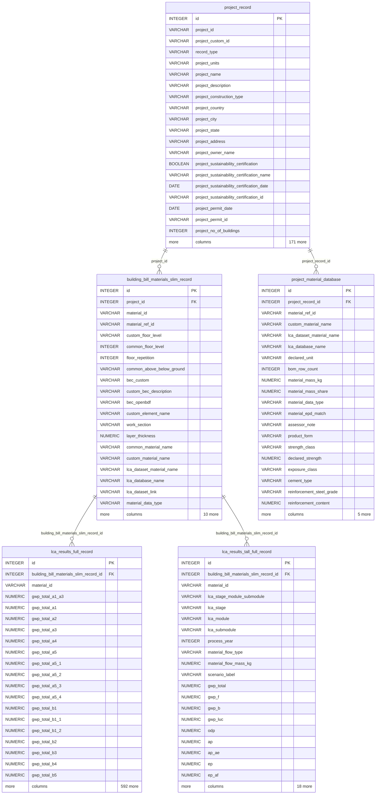

# Database ERD

Every table on `SQLModel.metadata` (`openbdf/model/tables.py`), generated with `make erd`.
Shows the first 20 columns of each table, keys first. Regenerate after changing the models.

